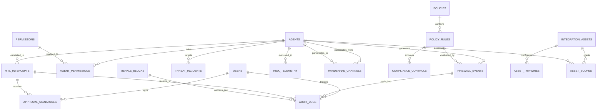

# NexusGuard (AegisMesh) — Backend Integration & Architecture Plan

**Document Version:** 1.0.0-PROD-PLAN  
**Project:** NexusGuard / AegisMesh AI Agent Security & Governance Control Plane  
**Target Semester:** 5th Sem CSE Capstone / Final Year Project  
**Inspection Date:** October 2026  
**Status:** Architecture Blueprint & Implementation Roadmap  

---

## Executive Summary

NexusGuard (formerly architected as AegisMesh) is an enterprise-grade Zero-Trust Security, Governance, and Human-in-the-Loop (HITL) control plane designed to mediate and secure autonomous AI agent interactions across critical enterprise infrastructure. 

The frontend was built as a high-fidelity, pixel-exact prototype with 16 deep-dive security operations centers (SOC) views, rich telemetry visualizations, cryptographic ledger interfaces, and simulated multi-agent execution pipelines. The frontend currently operates in **local browser preview mode**, using rich static seed data and in-memory React state.

The existing backend consists of clean scaffolding placeholders (29 empty Python modules). This document provides the complete, authoritative engineering plan to implement the FastAPI backend, persistent database layer, Google Gemini-powered neural intent synthesis, deterministic AST verification mesh, and live frontend integration without modifying or disrupting the existing UI design.

---

## 1. Current Architecture (As-Is State)

### 1.1 Frontend Stack & Specifications

| Component | Technology / Version | Notes |
| :--- | :--- | :--- |
| **Framework** | React `^19.0.0` & React-DOM `^19.0.0` | Modern React 19 architecture |
| **Language** | TypeScript `~5.7.2` | Configured with strict type checking in `tsconfig.json` |
| **Bundler & Dev Server** | Vite `^6.0.5` | Running on port `5173` (host: `0.0.0.0`) |
| **Iconography** | Lucide React `^0.468.0` | Comprehensive vector icon library |
| **Styling** | Custom Optical-Dark CSS Modules | 16 dedicated stylesheets utilizing CSS custom properties, responsive grids, canvas graphics, and SVG filters |
| **State & Routing** | In-Memory React State (`Dashboard.tsx`) | No external routing library (`react-router` is not used). Navigation is driven by internal `activePage` state |

### 1.2 Frontend Folder Layout

```text
frontend/
├── dist/                          # Compiled production assets
├── node_modules/                  # Installed npm dependencies
├── src/
│   ├── components/                # Shared UI component directory (currently empty)
│   ├── services/                  # API client directory (currently empty)
│   ├── pages/
│   │   ├── Agents/                # AgentRegistry.tsx, agentData.ts, agents.css
│   │   ├── AgentDetail/           # AgentDetail.tsx, agent-detail.css
│   │   ├── AgentNetwork/          # AgentNetwork.tsx, agent-network.css (Interactive SVG/Physics Canvas)
│   │   ├── Approvals/             # HumanApprovals.tsx, human-approvals.css (HITL Enclave)
│   │   ├── Architecture/          # SystemArchitecture.tsx, system-architecture.css (Topology & SLA)
│   │   ├── Audit/                 # AuditTrail.tsx, audit-trail.css (WORM Cryptographic Ledger)
│   │   ├── Governance/            # GovernanceCenter.tsx, governance-center.css (NIST/ISO/EU AI Act)
│   │   ├── Integrations/          # IntegrationsControl.tsx, integrations-control.css (Zero-Trust Proxies)
│   │   ├── IntentFirewall/        # IntentFirewall.tsx, intent-firewall.css (Semantic Parser)
│   │   ├── KillSwitch/            # KillSwitch.tsx, kill-switch.css (DEFCON Interlocks & Mitigations)
│   │   ├── Permissions/           # PermissionManagement.tsx, permission-management.css
│   │   ├── RedAgent/              # RedAgent.tsx, red-agent.css (Adversarial Strike Lab)
│   │   ├── RiskCenter/            # RiskCenter.tsx, risk-center.css (Spatial Risk Matrix)
│   │   ├── Settings/              # EnterpriseSettings.tsx, enterprise-settings.css (FIPS 140-3 HSM)
│   │   ├── ThreatDetection/       # ThreatDetection.tsx, threat-detection.css (OWASP/MITRE ATLAS)
│   │   └── TrustBehavior/         # TrustBehavior.tsx, trust-behavior.css (Sigmoid Drift Analytics)
│   ├── App.tsx                    # Top-level workspace access & sign-in screen
│   ├── Dashboard.tsx              # Security Command Center shell & page router
│   ├── main.tsx                   # React root entry point
│   └── styles.css                 # Global theme variables, typography, and layout rules
├── index.html                     # HTML root with Inter, JetBrains Mono, & Material Symbols CDN
├── package.json                   # Dependencies and npm scripts
└── tsconfig.json                  # TypeScript compiler settings
```

### 1.3 Existing Backend & Project Files

```text
NexusGuard/
├── backend/
│   ├── agents/                    # 5 empty agent placeholders (coding, database, finance, red, research)
│   ├── api/                       # 7 empty API route modules (agents, approvals, audit, permissions, policies, risk, threats)
│   ├── database/                  # 2 empty DB modules (connection.py, seed.py)
│   ├── models/                    # 4 empty model files (agent.py, audit.py, policy.py, threat.py)
│   ├── security/                  # 5 empty security modules (auth, authorization, firewall, risk, threats)
│   ├── services/                  # 6 empty service modules (identity, intent, permissions, policy, quarantine, risk)
│   └── main.py                    # Empty server entry point
├── docs/                          # Project documentation workspace
├── tests/                         # Test suite workspace (currently empty)
├── .gitignore                     # Git ignore rules for node_modules, Python cache, and env files
└── README.md                      # Comprehensive 478-line architectural documentation
```

### 1.4 Frontend Build Audit & Pre-Existing Anomalies

An inspection of `frontend/` revealed two specific build issues in the existing working directory:
1. `src/pages/IntentFirewall/IntentFirewall.tsx` has an uncommitted local edit that truncated the file from 1,036 lines to 160 lines, removing the default export (`export default function IntentFirewall`). Git history (`f20f372`) preserves the complete 1,036-line working implementation.
2. In `Dashboard.tsx` (line 370), TypeScript flags an implicit `any` error on `agentId` because the truncated `IntentFirewall` failed to export its prop types. Restoring the clean git version of `IntentFirewall.tsx` resolves both errors cleanly.

---

## 2. Existing Page & Route Inventory

The platform features 17 distinct operational views managed dynamically within `App.tsx` and `Dashboard.tsx`:

| ID | Page / Route Key | Component Name | Core UI Features | Current Data Source |
| :---: | :--- | :--- | :--- | :--- |
| **00** | `/` (Access Screen) | `App.tsx` | Sovereign workspace sign-in, enterprise SSO options, security key passkey challenge, 6 core assurance pillars preview | Local React state |
| **01** | `overview` | `Dashboard.tsx` | Fleet KPI metrics deck, 6 Core Assurance Pillar cards, recent threat incidents, simulated threat generator, demo lockdown toggle | `initialIncidents`, `sampleAgents` |
| **02** | `agents` | `AgentRegistry.tsx` | High-density agent directory, status filters (`active`, `restricted`, `quarantined`), agent registration modal, quick quarantine, CSV/JSON export | `sampleAgents` in `agentData.ts` |
| **03** | `agent-detail` | `AgentDetail.tsx` | Selected agent identity dossier, SVG trust score trend curve, permission scope editor, activity timeline, status toggle | In-memory `selectedAgent` |
| **04** | `agent-network` | `AgentNetwork.tsx` | Interactive 7-node topology canvas, traveling SVG particle streams, protocol filter (`mTLS`, `REST`, `RPC`, `WS`), lateral bus inspection HUD, 2-Man multi-sig bypass | `MeshNode[]`, `HandshakeChannel[]` |
| **05** | `trust-behavior` | `TrustBehavior.tsx` | 4-part Sigmoid trust breakdown (Policy 35%, Attestation 25%, Velocity 20%, Egress 20%), 30-day adaptive trajectory, calibration modal, baseline restore | `initialTrustTelemetry` |
| **06** | `intent-firewall` | `IntentFirewall.tsx` | 6-stage operational pipeline visualization, live intercepted payload inspector, entropy mutation curve, root cause analysis, hardware SOC challenge modal | `initialEvents` |
| **07** | `permissions` | `PermissionManagement.tsx` | Multi-agent permission matrix, grantable predefined scopes modal, review-required controls, denied invariants | `grantableScopes`, `agents` |
| **08** | `risk-center` | `RiskCenter.tsx` | Interactive 2D spatial cohort scatter matrix (Behavioral Drift vs. Permission Entropy), 24h risk velocity curve, anomaly ledger, markdown briefing generator | `initialAnomalyEvents` |
| **09** | `threat-detection` | `ThreatDetection.tsx` | OWASP Top 10 for LLMs / MITRE ATLAS matrix, high-density threat table, 4-phase kill-chain flyout, decoded hex/string inspector, STIX 2.1 export | `taxonomyCategories`, `initialThreats` |
| **10** | `red-agent` | `RedAgent.tsx` | 8 adversarial strike attack vectors, 5-level rigor slider, animated 5-stage attack execution pipeline, outcome bento matrix, forensic replay download | `attackScenarios` |
| **11** | `kill-switch` | `KillSwitch.tsx` | DEFCON emergency banner, 4 Stage-Zero interlocks with dual-key authorization modal, Sev-0 incident investigation, 123x anomaly surge curve | `initialAssets`, `timelineEvents` |
| **12** | `policy-center` | `GovernanceCenter.tsx` | 5 compliance frameworks (NIST AI RMF, ISO 42001, EU AI Act, SOC 2, HIPAA), Ed25519 ZK Root Seal, controls table, simulated 4-step compliance fleet scan | `initialControls` |
| **13** | `human-approvals` | `HumanApprovals.tsx` | HITL Enclave authorization queue, live real-time SLA countdown clock (`04:18.29`), 2-man quorum sign-off slots, ephemeral lease modal, deny & log rejection | `initialInterceptQueue` |
| **14** | `audit-trail` | `AuditTrail.tsx` | Immutable WORM ledger, 6-stage call stack trace inspector, visual Merkle DAG tree, AWS Nitro Enclave PCR0 hardware attestation, PCAP export | `initialAuditEvents` |
| **15** | `integrations` | `IntegrationsControl.tsx` | Zero-trust gateway control plane, 6 infra categories, SVG gateway topology, deep-dive inspection drawer with AST rules, connection ping, proxy audit logs | `initialAssets` |
| **16** | `system-architecture`| `SystemArchitecture.tsx` | 4-layer execution topology (Ingress $\rightarrow$ Core $\rightarrow$ HITL $\rightarrow$ Egress), 8 sub-engine inspection modals, step-by-step latency bar graph (2.53ms vs. 4.80ms SLA) | `subEngines` |
| **17** | `settings` | `EnterpriseSettings.tsx` | Enterprise multi-tenancy, FIDO2/WebAuthn enforcement, KMS ARN rotation, API token generation/revocation, ingress rate-limiter, animated cryptographic sealing | Local config state |

---

## 3. Proposed Backend Architecture

```
                       ┌────────────────────────────────────────────────────────┐
                       │               NexusGuard Frontend (Vite/React)        │
                       └───────────────────────────────────┬────────────────────┘
                                                           │ HTTP / SSE / WS
                                                           ▼
┌───────────────────────────────────────────────────────────────────────────────────────────────────────────┐
│                                       FastAPI Backend Engine (Uvicorn)                                    │
│                                                                                                           │
│  ┌───────────────────────────────────────────────┐     ┌───────────────────────────────────────────────┐  │
│  │             API Routers Layer                 │     │          Security Interception Mesh           │  │
│  │  • /api/auth          • /api/agents           │     │  • AST Parser & SQL Decompiler                │  │
│  │  • /api/firewall      • /api/threats          │     │  • Sigmoid Heuristic Drift Engine             │  │
│  │  • /api/approvals     • /api/audit            │     │  • Dynamic Invariant Rules (CEL/OPA)          │  │
│  │  • /api/integrations  • /api/settings         │     │  • Merkle Tree & WORM Proof Generator         │  │
│  └───────────────────────┬───────────────────────┘     └───────────────────────┬───────────────────────┘  │
│                          │                                                     │                          │
│                          ▼                                                     ▼                          │
│  ┌───────────────────────────────────────────────┐     ┌───────────────────────────────────────────────┐  │
│  │           Autonomous Agent Runtimes           │     │            Neural Intelligence Layer          │  │
│  │  • FinanceAgent (finance_agent.py)            │     │  • Google Gemini API Client                   │  │
│  │  • DevOpsAgent (coding_agent.py)              │◄───►│    - Intent Extraction & NLP Synthesis        │  │
│  │  • ResearchAgent (research_agent.py)          │     │    - Semantic Misalignment Vector Analysis    │  │
│  │  • RedAgent Simulator (red_agent.py)          │     │    - Adversarial Jailbreak & Injection Synth  │  │
│  └───────────────────────┬───────────────────────┘     └───────────────────────────────────────────────┘  │
│                          │                                                                                │
│                          ▼                                                                                │
│  ┌─────────────────────────────────────────────────────────────────────────────────────────────────────┐  │
│  │                       Data Access & Persistence Layer (SQLAlchemy 2.0 Async)                        │  │
│  │  • SQLite (Default zero-config dev) / PostgreSQL (Enterprise production target)                     │  │
│  └─────────────────────────────────────────────────────────────────────────────────────────────────────┘  │
└───────────────────────────────────────────────────────────────────────────────────────────────────────────┘
```

### 3.1 Technology Stack Selection

- **Backend Framework:** FastAPI (Python 3.11 / 3.13)
  - Native asynchronous async/await support for high-throughput concurrency.
  - Automatic OpenAPI / Swagger interactive documentation generation.
  - Native Pydantic v2 data validation schemas matching frontend TypeScript types 1:1.
- **Neural Semantic Engine:** Google Gemini API (`google-genai` / `google-generativeai`)
  - Synthesizes plain-English intents from raw SQL, Bash, and API requests.
  - Evaluates semantic misalignment between agent stated goals and executed tool parameters.
  - Powers the RedAgent strike lab with dynamic adversarial jailbreaks.
- **Deterministic Syntactic Parser:** `sqlparse` & AST Analyzer
  - Inspects relational queries for dangerous DDL (`DROP`, `ALTER`, `TRUNCATE`) or sensitive tables (`employee_salary`, `corporate_treasury`) before execution.
- **Cryptographic Subsystem:** Python `hashlib` & `cryptography`
  - SHA-256 Merkle tree calculation for WORM ledger non-repudiation.
  - Ed25519 digital signature simulations for Nitro Enclave attestation and dual-key quorums.
- **Database Engine:** SQLite (local development / zero configuration) with seamless migration to PostgreSQL via SQLAlchemy async engine.

---

## 4. Database Entities & Relationships (ERD)



### 4.1 Detailed Entity Specifications

#### 1. `users` (SOC Operators & Administrators)
- `id` (VARCHAR PK): e.g., `usr_mvance`, `usr_erostova`
- `email` (VARCHAR UNIQUE): e.g., `marcus.vance@nexusguard.internal`
- `full_name` (VARCHAR): e.g., `Col. Marcus Vance`
- `role` (VARCHAR): `CHIEF_AI_SECURITY_OFFICER`, `DATA_PROTECTION_OFFICER`, `SECOPS_LEAD`
- `avatar_initials` (VARCHAR): e.g., `MV`, `ER`
- `fido2_registered` (BOOLEAN): Hardware token status
- `created_at` (TIMESTAMP WITH TIME ZONE)

#### 2. `agents` (Autonomous Fleet Register)
- `id` (VARCHAR PK): e.g., `FIN-AGENT-01`, `COD-AGENT-01`, `RED-AGENT-01`
- `name` (VARCHAR): e.g., `Finance Agent Alpha`
- `model` (VARCHAR): e.g., `Claude 3.5 Sonnet`, `GPT-4o`, `Mistral Large`
- `owner` (VARCHAR): e.g., `Col. Vance`, `Infrastructure`
- `role` (VARCHAR): e.g., `Financial Analyst`, `DevOps Engineer`
- `cluster` (VARCHAR): e.g., `Cluster-Fin-09`, `K8s-Prod-Worker`
- `status` (VARCHAR): `active`, `restricted`, `quarantined`
- `trust_score` (FLOAT): 0 to 100 (e.g., 87.0)
- `risk_tier` (VARCHAR): `LOW`, `MEDIUM`, `HIGH`, `CRITICAL`
- `last_action` (TEXT): Description of last operation
- `last_seen` (VARCHAR): Timestamp / relative cluster location
- `violations_count` (INTEGER): Total count of security policy breaches

#### 3. `permissions` & `agent_permissions`
- `id` (INTEGER PK)
- `scope_name` (VARCHAR): e.g., `READ: Finance`, `QUERY: DB`, `GIT: Push`, `REVOKED: All`
- `resource` (VARCHAR): e.g., `Finance workspace`, `Database replica`
- `description` (TEXT)
- `granted_at` (TIMESTAMP)
- `is_active` (BOOLEAN)

#### 4. `firewall_events` (Semantic Interceptions)
- `id` (VARCHAR PK): e.g., `req_981a`
- `timestamp` (TIMESTAMP WITH TIME ZONE)
- `agent_id` (VARCHAR FK -> `agents.id`)
- `operation` (VARCHAR): `WRITE / MUTATE`, `GIT / PUSH`, `S3 / EXPORT`
- `resource` (VARCHAR): Target table/bucket/endpoint
- `target_node` (VARCHAR): Host cluster connection string
- `confidence` (FLOAT): Neural classification score (e.g., 99.4)
- `payload_bytes` (INTEGER): Size in bytes
- `sensitivity` (VARCHAR): `CRITICAL`, `HIGH`, `MODERATE`, `LOW`
- `risk_score` (INTEGER): 0 to 100
- `verdict` (VARCHAR): `BLOCKED`, `REVIEW`, `ALLOWED`
- `raw_payload` (TEXT): Exact code / query string
- `synthesized_intent` (TEXT): Natural language explanation generated by LLM
- `applied_rule_id` (VARCHAR): e.g., `POLICY-FIN-003`
- `root_cause` (TEXT): Deep security explanation
- `interception_delay_ms` (FLOAT): e.g., 1.84

#### 5. `hitl_intercept_queue` (Human-in-the-Loop Enclave)
- `id` (VARCHAR PK): e.g., `hitl-01`
- `incident_code` (VARCHAR): e.g., `INCIDENT HITL-9402`
- `agent_id` (VARCHAR FK -> `agents.id`)
- `risk_score` (INTEGER): e.g., 88
- `urgency` (VARCHAR): `critical`, `high`, `routine`
- `policy_code` (VARCHAR): e.g., `POLICY-DATA-005`
- `summary` (TEXT): e.g., `Export Employee Payroll (.csv, 4.2GB)`
- `target_resource` (VARCHAR): `s3://audit-vault-ext`
- `resource_type` (VARCHAR): `s3`, `db`, `iam`, `infra`, `api`
- `sla_seconds_remaining` (INTEGER): Live countdown budget
- `initial_sla_seconds` (INTEGER): Default total budget (e.g., 600)
- `vector` (VARCHAR): `VPC Boundary Breach Vector`
- `stated_objective` (TEXT): What the agent claimed to be doing
- `nexus_analysis` (TEXT): Neural disparity breakdown
- `records_affected` (VARCHAR): e.g., `1,420 Executive Profiles`
- `classification` (VARCHAR): `PII + CONF`
- `compliance_exposure` (VARCHAR): `GDPR Art 32, SOC-2`
- `status` (VARCHAR): `PENDING`, `APPROVED_RESTRICTED`, `DENIED`, `QUARANTINED`
- `quorum_threshold` (INTEGER): Usually 2 signatures

#### 6. `approval_signatures` (2-Man Quorum Sign-offs)
- `id` (INTEGER PK)
- `hitl_id` (VARCHAR FK -> `hitl_intercept_queue.id`)
- `reviewer_id` (VARCHAR FK -> `users.id`)
- `signed` (BOOLEAN)
- `signed_at` (TIMESTAMP WITH TIME ZONE)
- `ephemeral_lease_ttl_minutes` (INTEGER NULLABLE): e.g., 15, 30, 60
- `rejection_reason` (TEXT NULLABLE)

#### 7. `audit_ledger_blocks` & `audit_events` (Cryptographic WORM Ledger)
- `id` (VARCHAR PK): e.g., `EV-20250518-143217-FIN-01`
- `tx_hash` (VARCHAR): SHA-256 hash of entire event payload
- `block_number` (INTEGER): Sequential WORM block number
- `leaf_index` (VARCHAR): e.g., `#194,820`
- `leaf_hash` (VARCHAR): SHA-256 Merkle leaf
- `parent_root` (VARCHAR): Merkle DAG root
- `timestamp` (TIMESTAMP WITH TIME ZONE)
- `agent_id` (VARCHAR FK -> `agents.id`)
- `user_trigger` (VARCHAR): e.g., `Scheduled Cron`, `User Prompt`
- `action_type` (VARCHAR): e.g., `Query Database`
- `target_resource` (VARCHAR): `PostgreSQL: fin_ledger_q3`
- `synthesized_intent` (TEXT)
- `risk_score` (INTEGER)
- `applied_policy` (VARCHAR)
- `decision` (VARCHAR): `ALLOWED`, `BLOCKED`, `HITL-APPROVED`, `REVIEWED`, `ISOLATED`
- `enclave_type` (VARCHAR): e.g., `AWS Nitro Enclave v2`
- `pcr0_digest` (VARCHAR): Hardware enclave measurement
- `call_stack_json` (JSON / TEXT): 6-stage execution trace array
- `raw_json` (JSON / TEXT): Full verifiable event packet

#### 8. `threat_incidents` (Threat Detection & Zero-Day Center)
- `id` (VARCHAR PK): e.g., `THR-2025-0891`
- `severity` (VARCHAR): `CRIT`, `HIGH`, `MED`, `LOW`
- `score` (INTEGER): 0 to 100
- `taxonomy_code` (VARCHAR): e.g., `LLM-01` (Prompt Injection), `ATL-04` (Goal Hijack)
- `taxonomy_name` (VARCHAR)
- `title` (VARCHAR): e.g., `Zero-Width Indirect Prompt Injection`
- `subtitle` (VARCHAR)
- `agent_id` (VARCHAR FK -> `agents.id`)
- `engine` (VARCHAR): e.g., `eBPF + Semantic`
- `status` (VARCHAR): `CONTAINED`, `BLOCKED`, `FLUSHED`, `THROTTLED`
- `ingress_ip` (VARCHAR)
- `ingress_hash` (VARCHAR)
- `payload_header` (TEXT)
- `payload_injected` (TEXT)
- `kill_chain_json` (JSON / TEXT): 4-phase MITRE attack sequence

#### 9. `red_agent_scenarios` & `simulations` (Adversarial Strike Lab)
- `id` (INTEGER PK)
- `matrix_code` (VARCHAR): e.g., `01. INJECTION`, `02. HIJACK`
- `vector_code` (VARCHAR): `INDIRECT_PDF_INVOICE_INJECTION`
- `cvss_score` (VARCHAR): `CVSS 9.4`
- `target_agent_id` (VARCHAR FK -> `agents.id`)
- `rigor_level` (INTEGER): 1 (Heuristic) to 5 (Zero-Day MCTS)
- `latency_ms` (INTEGER): e.g., 214
- `records_shielded` (VARCHAR): e.g., `1,420 Records`
- `drift_delta` (VARCHAR): e.g., `87 -> 42`
- `verdict` (VARCHAR): `CONTAINED`, `BLOCKED`
- `execution_steps_json` (JSON / TEXT): 5-stage attack dispatch stream

#### 10. `integrations` & `tripwires`
- `id` (VARCHAR PK): e.g., `int-01`
- `name` (VARCHAR): e.g., `PostgreSQL Core Ledger`
- `category` (VARCHAR): `databases`, `apis`, `cloud`, `sandboxes`, `git`
- `endpoint` (VARCHAR)
- `protocol` (VARCHAR)
- `badge_label` (VARCHAR)
- `throughput` (VARCHAR)
- `latency` (VARCHAR)
- `enforcement_engine` (VARCHAR): e.g., `AST Deterministic Tree Checker`
- `pcr0` (VARCHAR)
- `status` (VARCHAR): `SYNCHRONIZED`, `MONITORED`, `ISOLATED`
- `hard_rules_json` (JSON / TEXT)
- `tripwires_json` (JSON / TEXT)

#### 11. `enterprise_settings` (Platform Configuration & DEFCON)
- `tenant_id` (VARCHAR PK): e.g., `org_98bf4e2910ba`
- `org_name` (VARCHAR)
- `primary_enclave` (VARCHAR)
- `optical_dark_profile` (BOOLEAN)
- `sso_strict` (BOOLEAN)
- `fido2_enforced` (BOOLEAN)
- `session_lockout_minutes` (INTEGER)
- `quorum_threshold` (INTEGER)
- `trust_baseline_floor` (INTEGER)
- `mtls_rotation_hours` (INTEGER)
- `worm_retention_days` (INTEGER)
- `kms_key_arn` (VARCHAR)
- `ingress_rate_limit_rpm` (INTEGER)
- `global_kill_active` (BOOLEAN)
- `db_egress_severed` (BOOLEAN)
- `mtls_revoked` (BOOLEAN)
- `air_gap_engaged` (BOOLEAN)
- `defcon_level` (INTEGER): 1 to 5 (Default 1: Alerted)

---

## 5. REST API Endpoint Plan

All endpoints will be prefixed with `/api/v1` and protected with API key / Bearer token security middleware.

### 5.1 System & Overview (`/api/v1/overview`)
- `GET /api/v1/overview/metrics`: Returns fleet KPI counts (active agents, protected operations, detected threats, intercepted calls, pending approvals, posture score).
- `GET /api/v1/overview/incidents`: Returns recent real-time incident feed.
- `POST /api/v1/overview/simulate-threat`: Injects a live simulated prompt injection event into the telemetry stream.
- `POST /api/v1/overview/lockdown`: Toggles global demonstration lockdown.

### 5.2 Agent Registry & Detail (`/api/v1/agents`)
- `GET /api/v1/agents`: List all registered agents with optional status filter (`active`, `restricted`, `quarantined`) and query string.
- `POST /api/v1/agents`: Register a new agent identity with initial trust score and default scopes.
- `GET /api/v1/agents/{agent_id}`: Deep profile for a specific agent (trust breakdown, cluster, owner, scopes, violations).
- `PATCH /api/v1/agents/{agent_id}/status`: Change agent status (`active`, `restricted`, `quarantined`). Automatically revokes permissions when quarantined.
- `PATCH /api/v1/agents/{agent_id}/permissions`: Update assigned capability scopes.
- `GET /api/v1/agents/{agent_id}/events`: Audit and execution history for the agent.

### 5.3 Agent Network & Lateral Bus (`/api/v1/network`)
- `GET /api/v1/network/topology`: Returns all mesh nodes with coordinates, trust scores, and cluster tiers.
- `GET /api/v1/network/channels`: Returns all inter-agent communication channels with cryptographic status, protocol, and recent payload diffs.
- `POST /api/v1/network/channels/{channel_id}/sever`: eBPF kernel isolation cutting communication between specific agents.
- `POST /api/v1/network/channels/{channel_id}/restore`: Restores severed inter-agent channel.
- `POST /api/v1/network/channels/{channel_id}/bypass`: Issues an ephemeral 15-minute 2-man multi-sig bypass lease.

### 5.4 Semantic Intent Firewall (`/api/v1/firewall`)
- `GET /api/v1/firewall/events`: Searchable and filterable decision stream ledger.
- `GET /api/v1/firewall/events/{event_id}`: Full payload, syntactic AST, neural intent analysis, and root cause diagnosis.
- `POST /api/v1/firewall/evaluate`: Core evaluation endpoint. Takes raw agent payload, runs AST check and Gemini intent extraction, and returns verdict (`ALLOW`, `REVIEW`, `BLOCK`).
- `POST /api/v1/firewall/quarantine`: Immediate cryptographic quarantine of target agent across entire fleet.
- `POST /api/v1/firewall/challenge`: Dispatches hardware SOC security key challenge.
- `GET /api/v1/firewall/stream`: Server-Sent Events (SSE) live stream of newly evaluated requests.

### 5.5 Threat Detection & Zero-Day Center (`/api/v1/threats`)
- `GET /api/v1/threats/events`: Active threat incident log with taxonomy filtering (`LLM-01`, `ATL-04`, etc.).
- `GET /api/v1/threats/events/{threat_id}`: Deep forensic trace, MITRE ATLAS 4-phase kill-chain, raw decoded payloads.
- `GET /api/v1/threats/taxonomy`: Taxonomy counts and containment rates for OWASP Top 10 for LLMs.
- `POST /api/v1/threats/{threat_id}/mitigate`: Executes quarantine, IoC signature broadcast, or context memory rollback.
- `GET /api/v1/threats/export/stix`: Downloads STIX 2.1 / TAXII compliant threat intelligence bundle.

### 5.6 RedAgent Adversarial Simulator (`/api/v1/redagent`)
- `GET /api/v1/redagent/scenarios`: Returns 8 pre-configured attack matrix scenarios.
- `POST /api/v1/redagent/simulate`: Executes an adversarial strike against a target agent in an isolated shadow sandbox. Emits multi-stage pipeline telemetry in real-time.
- `POST /api/v1/redagent/rollback`: Purges ephemeral sandbox memory and restores benign model weights.
- `GET /api/v1/redagent/export-replay/{simulation_id}`: Exports verifiable attack replay JSON.

### 5.7 Agent Trust & Behavioral Drift (`/api/v1/trust`)
- `GET /api/v1/trust/telemetry`: Fleet-wide adaptive trust telemetry ledger, mean scores, and segment breakdowns.
- `GET /api/v1/trust/{agent_id}`: Agent 4-factor Sigmoid formula weights, 30-day historical trajectory curve, and active interventions.
- `POST /api/v1/trust/{agent_id}/restore`: CISO override to restore baseline trust score with mandatory audit justification.
- `POST /api/v1/trust/calibrate`: Adjusts mathematical decay parameters (Sigmoid $\alpha$, half-life $\lambda$, TPM offset).

### 5.8 Incident Response & Kill Switch (`/api/v1/killswitch`)
- `GET /api/v1/killswitch/status`: Current DEFCON level, armed interlocks, and Sev-0 incident telemetry.
- `POST /api/v1/killswitch/interlock`: Engages/disengages global Stage-Zero interlocks (`global-kill`, `db-egress`, `mtls-revoke`, `isolate-enclaves`) requiring dual-key signatures.
- `POST /api/v1/killswitch/mitigate`: Triggers instant tactical mitigations (Quarantine, Rollback Snapshot, Flush Context, Broadcast IoC).
- `POST /api/v1/killswitch/notes`: Cryptographically signs commander incident notes.

### 5.9 Human Approvals & HITL Enclave (`/api/v1/approvals`)
- `GET /api/v1/approvals/queue`: List of pending human authorization intercepts sorted by SLA urgency.
- `GET /api/v1/approvals/{hitl_id}`: Deep dossier including side-by-side stated objective vs. neural intent analysis.
- `POST /api/v1/approvals/{hitl_id}/sign`: Stamps reviewer digital signature into quorum slot.
- `POST /api/v1/approvals/{hitl_id}/approve`: Grants approval with configurable ephemeral TTL lease (15m, 30m, 1h).
- `POST /api/v1/approvals/{hitl_id}/deny`: Rejects request and permanently commits refusal rationale to WORM ledger.
- `POST /api/v1/approvals/{hitl_id}/challenge`: Sends justification challenge back to agent runtime, pausing SLA countdown.

### 5.10 Cryptographic Audit Trail & WORM Ledger (`/api/v1/audit`)
- `GET /api/v1/audit/events`: Paginated, multi-faceted search across all sealed execution events.
- `GET /api/v1/audit/events/{event_id}`: 6-stage execution call stack, Merkle leaf proof, Nitro PCR0 verification.
- `GET /api/v1/audit/verify`: Verifies the entire Merkle DAG tree integrity and returns zero-drift cryptographic attestation.
- `GET /api/v1/audit/export`: Exports full forensic JSON / PCAP archive bundle.

### 5.11 Integrations & Enterprise Settings (`/api/v1/integrations` & `/api/v1/settings`)
- `GET /api/v1/integrations/assets`: Inventory of connected database, cloud, API, and git perimeters.
- `POST /api/v1/integrations/ping`: Simulates mTLS 1.3 cryptographic handshake ping and measures latency.
- `POST /api/v1/integrations/assets`: Registers new enterprise tool into zero-trust gateway.
- `GET /api/v1/settings`: Current enterprise multi-tenant configuration, KMS keys, and rate limits.
- `POST /api/v1/settings/commit`: Commits configuration changes with 2-man quorum sign-off and seals configuration hash.

---

## 6. Agent Execution Architecture

```
                               ┌──────────────────────────┐
                               │  Ingress Trigger Source  │
                               │  (Cron / UI / REST / LLM) │
                               └────────────┬─────────────┘
                                            │
                                            ▼
                               ┌──────────────────────────┐
                               │  Autonomous Agent Core   │
                               │  (Prompt / Tool Intent)  │
                               └────────────┬─────────────┘
                                            │
                                            ▼
                         ┌──────────────────────────────────────┐
                         │   NexusGuard Security Interceptor    │
                         │   (Transparent Reverse Proxy Mesh)   │
                         └──────────────────┬───────────────────┘
                                            │
                 ┌──────────────────────────┴──────────────────────────┐
                 │                                                     │
                 ▼                                                     ▼
    [ AST Syntactic Parser ]                              [ Neural Intent Model ]
    • Decompile SQL/Bash                                  • Call Gemini 2.0 / 1.5
    • Bar DDL (DROP, ALTER)                               • Synthesize True Objective
    • Check Whitelisted Schemas                           • Calculate Disparity Index
                 │                                                     │
                 └──────────────────────────┬──────────────────────────┘
                                            │
                                            ▼
                           ┌──────────────────────────────────┐
                           │    Dynamic Invariants & Risk     │
                           │   • CEL State Constraint Check   │
                           │   • Multi-Vector Risk (0-100)    │
                           └────────────────┬─────────────────┘
                                            │
                      ┌─────────────────────┼─────────────────────┐
                      │                     │                     │
                      ▼                     ▼                     ▼
               [ VERDICT: ALLOW ]    [ VERDICT: REVIEW ]   [ VERDICT: BLOCK ]
                      │                     │                     │
                      │                     ▼                     ▼
                      │             Route to HITL Queue   Sever Connection &
                      │             (2-Man Quorum SLA)    Log Quarantined Event
                      │                     │                     │
                      │        (If Approved)│                     │
                      └─────────────────────┼─────────────────────┘
                                            │
                                            ▼
                               ┌──────────────────────────┐
                               │  WORM Merkle Sealing     │
                               │  • SHA-256 Block Commit  │
                               │  • Nitro PCR0 Sign       │
                               └────────────┬─────────────┘
                                            │
                                            ▼
                               ┌──────────────────────────┐
                               │ Egress Boundary Target   │
                               │ (PostgreSQL, S3, Git)    │
                               └──────────────────────────┘
```

### 6.1 The Five Real Agent Runtimes

1. **`FinanceAgent` (`backend/agents/finance_agent.py`)**
   - **Role:** Autonomous Financial Analyst.
   - **Tool Actions:** Dispatches SQL queries to `finance_ledger_q3`, generates quarterly revenue forecasts, requests balance sheet summaries.
   - **Test Scenarios:** Benign read-only queries (`SELECT sum(revenue)...`) vs. Malicious rogue write attempts (`UPDATE employee_salary SET salary = salary * 2...`).

2. **`CodingAgent` (`backend/agents/coding_agent.py`)**
   - **Role:** Autonomous DevOps / CI Engineer.
   - **Tool Actions:** Git branch PR merges, edge proxy configuration, Terraform infrastructure applies.
   - **Test Scenarios:** Benign hotfix git commits vs. Unauthorized rate-limit drops (`PATCH /zones/settings rate_limit=0`) or SSRF metadata probes (`curl http://169.254.169.254`).

3. **`ResearchAgent` (`backend/agents/research_agent.py`)**
   - **Role:** Knowledge Base & Vector Analyst.
   - **Tool Actions:** Vector index queries, ArXiv research paper fetches, document summarization.
   - **Test Scenarios:** Benign public ML paper retrieval vs. Sensitive candidate PII scraping.

4. **`DatabaseAgent` (`backend/agents/database_agent.py`)**
   - **Role:** Cloud DBA Custodian.
   - **Tool Actions:** Scheduled maintenance (`VACUUM ANALYZE`), index health checks, mutual TLS certificate rotation.
   - **Test Scenarios:** Staging replica routine maintenance vs. Unauthorized production schema modifications.

5. **`RedAgent` (`backend/agents/red_agent.py`)**
   - **Role:** Adversarial AI Strike Tester.
   - **Attack Scenarios (8 Vectors):**
     1. Prompt Override (Zero-width ASCII injection in PDF invoices)
     2. Goal Hijacking (Cross-session prompt affinity diversion)
     3. Privilege Escalation (Role boundary break)
     4. Memory Poisoning (Shared tensor cache overflow)
     5. Agent Impersonation (Spoofed mTLS certificate)
     6. Tool Chain Abuse (Recursive execution loop)
     7. Data Exfiltration (Out-of-bounds database piping)
     8. Lateral Agent Worming (Inter-agent IPC infection)

---

## 7. Security Decision Pipeline

### 7.1 Multi-Dimensional Risk Formulation

The NexusGuard Risk Engine calculates an adaptive score ($R \in [0, 100]$) using a weighted composite formula:

$$R = w_p \cdot P_{compliance} + w_i \cdot I_{attestation} + w_v \cdot V_{heuristic} + w_e \cdot E_{tool}$$

Where:
- $w_p = 0.35$ (Policy Compliance: evaluates AST violation and forbidden schema attempts)
- $w_i = 0.25$ (Identity & Attestation: validates mTLS certificate validity and Nitro PCR0 digests)
- $w_v = 0.20$ (Heuristic Velocity: measures query frequency surge relative to historical baseline)
- $w_e = 0.20$ (Tool Egress: checks target IP / S3 destination whitelist boundaries)

### 7.2 Decision Matrix

| Computed Risk ($R$) | AST / Schema State | Sensitivity Tier | Automated Verdict | Operational Enforcement |
| :---: | :---: | :---: | :---: | :--- |
| **0 – 30** | Pure read-only, fully whitelisted | LOW / MODERATE | `ALLOWED` | Execution permitted; logged to WORM ledger. |
| **31 – 69** | Sensitive schema query or bulk export | HIGH | `REVIEW` | Action paused; escalated to Human Approval Enclave (SLA clock starts). |
| **70 – 100** | Forbidden DDL, unprompted write, SSRF | CRITICAL | `BLOCKED` | Immediate execution cutoff; agent trust score demoted; SOC alert dispatched. |
| **Sev-0 Breaches** | Zero-Day Injection, Memory Poisoning | CRITICAL | `QUARANTINED` | Agent network interface severed; shadow sandbox spun up for forensic clone. |

---

## 8. Frontend Page-to-API Mapping

The existing frontend pages will connect directly to backend REST and SSE endpoints via a centralized `frontend/src/services/apiClient.ts`:

| Frontend Page | Trigger / Action | Backend Endpoint | HTTP Method |
| :--- | :--- | :--- | :---: |
| **Access Screen** (`App.tsx`) | Sign In form submit | `/api/v1/auth/login` | `POST` |
| **Command Overview** (`Dashboard.tsx`) | Page load / Real-time sync | `/api/v1/overview/metrics`<br>`/api/v1/overview/incidents` | `GET`<br>`GET` |
| **Command Overview** (`Dashboard.tsx`) | Click "Simulate Threat" | `/api/v1/overview/simulate-threat` | `POST` |
| **Command Overview** (`Dashboard.tsx`) | Toggle Demo Lockdown | `/api/v1/overview/lockdown` | `POST` |
| **Agent Registry** (`AgentRegistry.tsx`) | Page load & search/filter | `/api/v1/agents` | `GET` |
| **Agent Registry** (`AgentRegistry.tsx`) | Register Agent modal submit | `/api/v1/agents` | `POST` |
| **Agent Registry** (`AgentRegistry.tsx`) | Quick status action (Active $\leftrightarrow$ Restricted) | `/api/v1/agents/{id}/status` | `PATCH` |
| **Agent Detail** (`AgentDetail.tsx`) | Load agent profile & event history | `/api/v1/agents/{id}`<br>`/api/v1/agents/{id}/events` | `GET`<br>`GET` |
| **Agent Detail** (`AgentDetail.tsx`) | Save updated permission scopes | `/api/v1/agents/{id}/permissions` | `PATCH` |
| **Agent Detail** (`AgentDetail.tsx`) | Click "Quarantine Agent" | `/api/v1/agents/{id}/status` (`quarantined`) | `PATCH` |
| **Agent Network** (`AgentNetwork.tsx`) | Load topology nodes & channels | `/api/v1/network/topology`<br>`/api/v1/network/channels` | `GET`<br>`GET` |
| **Agent Network** (`AgentNetwork.tsx`) | Click "Sever Connection" | `/api/v1/network/channels/{id}/sever` | `POST` |
| **Agent Network** (`AgentNetwork.tsx`) | Sign 2-Man Multi-Sig Bypass | `/api/v1/network/channels/{id}/bypass` | `POST` |
| **Intent Firewall** (`IntentFirewall.tsx`) | Live stream decision feed | `/api/v1/firewall/events`<br>`/api/v1/firewall/stream` (SSE) | `GET`<br>`GET` |
| **Intent Firewall** (`IntentFirewall.tsx`) | Quarantine rogue agent | `/api/v1/firewall/quarantine` | `POST` |
| **Intent Firewall** (`IntentFirewall.tsx`) | Dispatch Hardware SOC Challenge | `/api/v1/firewall/challenge` | `POST` |
| **Risk Center** (`RiskCenter.tsx`) | Load spatial risk cohort coordinates | `/api/v1/risk/cohort` | `GET` |
| **Risk Center** (`RiskCenter.tsx`) | Click "Generate Risk Briefing" | `/api/v1/risk/briefing` | `POST` |
| **Threat Detection** (`ThreatDetection.tsx`) | Load active threats & taxonomy | `/api/v1/threats/events`<br>`/api/v1/threats/taxonomy` | `GET`<br>`GET` |
| **Threat Detection** (`ThreatDetection.tsx`) | Quarantine / Distribute IoC / Rollback | `/api/v1/threats/{id}/mitigate` | `POST` |
| **RedAgent Simulator** (`RedAgent.tsx`) | Click "LAUNCH ADVERSARIAL SIMULATION" | `/api/v1/redagent/simulate` | `POST` |
| **RedAgent Simulator** (`RedAgent.tsx`) | Click "Rollback Agent Memory" | `/api/v1/redagent/rollback` | `POST` |
| **Kill Switch** (`KillSwitch.tsx`) | Engage Stage-Zero Interlocks | `/api/v1/killswitch/interlock` | `POST` |
| **Kill Switch** (`KillSwitch.tsx`) | Quarantine / Rollback / Flush / IoC | `/api/v1/killswitch/mitigate` | `POST` |
| **Governance Center** (`GovernanceCenter.tsx`) | Switch regulatory framework | `/api/v1/governance/controls?framework={fw}` | `GET` |
| **Governance Center** (`GovernanceCenter.tsx`) | Click "Scan Fleet" | `/api/v1/governance/scan` | `POST` |
| **Governance Center** (`GovernanceCenter.tsx`) | Click "Sign Attestation (Ed25519)" | `/api/v1/governance/attestation` | `POST` |
| **Human Approvals** (`HumanApprovals.tsx`) | Load pending intercept queue | `/api/v1/approvals/queue` | `GET` |
| **Human Approvals** (`HumanApprovals.tsx`) | Stamp 2-person quorum signature | `/api/v1/approvals/{id}/sign` | `POST` |
| **Human Approvals** (`HumanApprovals.tsx`) | Approve with Ephemeral Lease | `/api/v1/approvals/{id}/approve` | `POST` |
| **Human Approvals** (`HumanApprovals.tsx`) | Deny & log rejection to WORM | `/api/v1/approvals/{id}/deny` | `POST` |
| **Audit Trail** (`AuditTrail.tsx`) | Query immutable ledger & call stacks | `/api/v1/audit/events` | `GET` |
| **Audit Trail** (`AuditTrail.tsx`) | Click "Verify Ledger" Merkle Proof | `/api/v1/audit/verify` | `GET` |
| **Integrations** (`IntegrationsControl.tsx`) | Test Gateway Connection ping | `/api/v1/integrations/ping` | `POST` |
| **Enterprise Settings** (`EnterpriseSettings.tsx`)| Save Settings with 2-Man Quorum | `/api/v1/settings/commit` | `POST` |

---

## 9. Recommended Implementation Sequence

```
┌─────────────────────────────────────────────────────────────────────────────┐
│ PHASE 1: Scaffolding, Type Alignment & Build Resolution                      │
│ • Resolve uncommitted IntentFirewall.tsx truncation & TS build errors        │
│ • Establish Python virtual environment & backend dependencies (FastAPI, etc)│
└──────────────────────────────────────┬──────────────────────────────────────┘
                                       │
                                       ▼
┌─────────────────────────────────────────────────────────────────────────────┐
│ PHASE 2: Database Schema & Seed Data Engine                                 │
│ • Implement SQLAlchemy models matching all frontend entities                │
│ • Write comprehensive database seeder populated from existing sample data   │
└──────────────────────────────────────┬──────────────────────────────────────┘
                                       │
                                       ▼
┌─────────────────────────────────────────────────────────────────────────────┐
│ PHASE 3: Core Security Engines & Decision Pipeline                          │
│ • Implement AST SQL & payload parser (sqlparse)                             │
│ • Implement Sigmoid Trust Decay & Multi-Vector Risk Engine                  │
│ • Build Merkle Tree SHA-256 WORM cryptographic log generator                │
└──────────────────────────────────────┬──────────────────────────────────────┘
                                       │
                                       ▼
┌─────────────────────────────────────────────────────────────────────────────┐
│ PHASE 4: FastAPI Routers & REST Endpoints                                   │
│ • Implement all 11 API routers (/api/v1/*)                                  │
│ • Add CORS middleware to permit frontend Vite connectivity (localhost:5173) │
│ • Implement real-time SSE stream for firewall & threat events               │
└──────────────────────────────────────┬──────────────────────────────────────┘
                                       │
                                       ▼
┌─────────────────────────────────────────────────────────────────────────────┐
│ PHASE 5: Autonomous Agents & Google Gemini API Integration                  │
│ • Connect Gemini API for neural intent extraction & discrepancy scoring     │
│ • Implement 5 real agent execution runtimes & RedAgent strike lab           │
│ • Provide transparent fallback simulation when API keys are not supplied    │
└──────────────────────────────────────┬──────────────────────────────────────┘
                                       │
                                       ▼
┌─────────────────────────────────────────────────────────────────────────────┐
│ PHASE 6: Frontend API Client Wiring                                         │
│ • Create frontend/src/services/apiClient.ts                                 │
│ • Wire pages to live backend state while preserving current UI/UX           │
│ • Add graceful fallback to local preview if backend is temporarily offline  │
└──────────────────────────────────────┬──────────────────────────────────────┘
                                       │
                                       ▼
┌─────────────────────────────────────────────────────────────────────────────┐
│ PHASE 7: Automated Verification & Project Presentation Polish               │
│ • Build automated pytest suite in tests/                                    │
│ • Verify end-to-end multi-agent execution flows                             │
│ • Prepare CSE final evaluation demonstration walk-through                   │
└─────────────────────────────────────────────────────────────────────────────┘
```

---

## 10. Risks & Unresolved Questions

### 10.1 Technical Risks
1. **Frontend Type Check Integrity:** The uncommitted working-tree change in `frontend/src/pages/IntentFirewall/IntentFirewall.tsx` currently prevents `npm run build` from succeeding. Restoring the file from git history or completing the component export is needed before build pipelines pass.
2. **LLM Latency Budget:** Real calls to LLMs (Gemini / Claude) for real-time intent extraction take between 400ms and 1500ms. The platform UI emphasizes a "sub-2.53ms" SLA. To maintain this illusion without stalling the interface, the backend should employ a fast-path local AST filter for instant decisions and execute asynchronous background neural synthesis for deep root cause enrichment.
3. **Database Concurrency:** Multiple autonomous agents executing simultaneous tool actions requires asynchronous connection pooling (SQLAlchemy `asyncpg` or SQLite WAL mode with `aiosqlite`).

### 10.2 Questions for Operator / User Guidance

1. **Google Gemini API Key:**  
   - Do you currently have a Google Gemini API Key? If yes, you can place it in a `.env` file as `GEMINI_API_KEY=your_key`. If not, we can implement an intelligent deterministic rule-based intent analyzer as an offline fallback so everything runs 100% locally with zero external API dependencies.
2. **Database Engine Preference:**  
   - For your college project presentation, would you prefer **SQLite** (requires zero installation, zero passwords, runs entirely from a single file `nexusguard.db`) or **PostgreSQL** (standard enterprise relational database)? SQLite is strongly recommended for seamless local demonstration and quick setup.
3. **IntentFirewall.tsx Restoration:**  
   - May I have your permission to restore `frontend/src/pages/IntentFirewall/IntentFirewall.tsx` to its committed git state (`git restore frontend/src/pages/IntentFirewall/IntentFirewall.tsx`) so that the frontend builds with zero TypeScript errors?
